<picture>
  <source media="(max-width: 600px)" srcset="./assets/header-mobile.svg">
  
</picture>

<h1 align="center">Olá, eu sou o Vitor 👋</h1>

  <strong>Inteligência artificial, contexto e código para transformar ideias em aplicações.</strong>

  
  &nbsp;
  

  <a href="#sobre-mim">Sobre mim</a> ·
  <a href="#experiências">Experiências</a> ·
  <a href="#tecnologias">Tecnologias</a> ·
  <a href="#pesquisa">Pesquisa</a>

## Sobre mim

Sou **Vitor Eduardo de Lima Kenor**, **AI Engineer** e estudante de **Ciência da Computação na UTFPR**. Trabalho com **IA aplicada: LLMs, RAG, agentes e automações**, conectando modelos de linguagem a dados e ferramentas para resolver problemas reais de empresas.

Gosto de entender o problema antes de pensar na solução — e de ver uma ideia sair do papel para se tornar algo que as pessoas usam. Meu foco é transformar processos manuais em aplicações e fluxos inteligentes com **Python**.

🎮 **Além do código do dia a dia:** gosto de games e também desenvolvo meus próprios jogos nas horas vagas.

## Experiências

### BigLink · Engenheiro de IA Júnior

**Out. 2024 — atual** · Estágio · Remoto

- Desenvolvimento de **agente NL2SQL**, que transforma perguntas em linguagem natural em consultas SQL.
- Aplicação de **processamento de linguagem natural (NLP)** à análise e otimização de campanhas de marketing digital em diferentes plataformas.

### LAMIA · Membro do Laboratório de IA

**Abr. 2024 — atual** · Temporário · Híbrido · Santa Helena–PR

- Integro o laboratório de inteligência artificial da UTFPR, que desenvolve **pesquisa e desenvolvimento em IA em parceria com empresas**.
- Participei do bootcamp do laboratório, com formação intensiva em **Python, Machine Learning, LLMs, RAG, Docker e visão computacional**, voltada à atuação em projetos reais.

[Mais sobre minha trajetória no LinkedIn →](https://www.linkedin.com/in/vitor-eduardo-de-lima-kenor-803464273/)

## Tecnologias

Minha stack em destaque, com foco em **IA aplicada e automação**:

| Foco | Principais tecnologias |
| :--- | :--- |
| **IA e agentes** | **LLMs · RAG · LangChain** |
| **Aplicações e APIs** | **Python · FastAPI** |
| **Dados e nuvem** | **PostgreSQL · Google Cloud** |
| **Automação e infraestrutura** | **n8n · Docker** |

## Pesquisa

Também levo meu interesse por IA para a pesquisa acadêmica:

> **Menos complexidade, mais contexto: um framework RAG para recuperação de exemplos em Text2SQL** 
> Trabalho com Thiago França Naves, publicado nos anais do **SEI/SICITE 2025 — UTFPR**. 
> [Consultar a publicação →](https://www.even3.com.br/anais/sei-sicite-2025-593680/1269391-menos-complexidade-mais-contexto--um-framework-rag-para-recuperacao-de-exemplos-em-text2sql/)

---

### Vamos conversar?

Tem uma ideia, um projeto ou quer trocar experiências sobre Python e inteligência artificial? Entre em contato pelo [LinkedIn](https://www.linkedin.com/in/vitor-eduardo-de-lima-kenor-803464273/) ou pelo e-mail **[vitoreduardokenor@gmail.com](mailto:vitoreduardokenor@gmail.com)**.

Aprendendo, experimentando e construindo — um projeto de cada vez.

<picture>
  <source media="(prefers-color-scheme: dark)" srcset="https://raw.githubusercontent.com/platane/platane/output/github-contribution-grid-snake-dark.svg">
  <source media="(prefers-color-scheme: light)" srcset="https://raw.githubusercontent.com/platane/platane/output/github-contribution-grid-snake.svg">
  
</picture>
